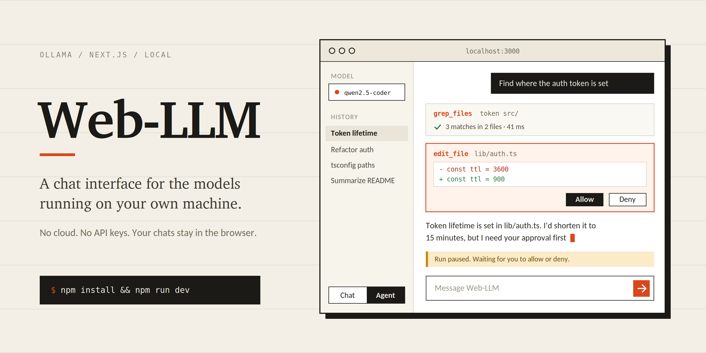

<p align="center">
  
</p>

# Web-LLM

A clean, ChatGPT-style web interface for the language models running on your own
machine. No cloud, no API keys, no command line — start the server, open the
browser, pick a model, and type.

Built with Next.js 14 (App Router), TypeScript, Tailwind CSS, and Lucide icons.
Chat history lives in your browser's `localStorage`, so there is no database to
set up and nothing leaves your computer.

---

## Setup

**1. Install Ollama** from [ollama.com](https://ollama.com) and make sure the
service is running:

```bash
ollama serve      # usually already running as a background service
```

**2. Pull at least one model.** The app shows this list as a helpful reminder if
you haven't:

```bash
ollama pull llama3.2          # 3B — small, fast, good all-rounder
ollama pull qwen2.5-coder:7b  # strong at code
ollama pull deepseek-r1:7b    # shows its reasoning step by step
```

**3. Install and run this app:**

```bash
npm install
npm run dev
```

Open **http://localhost:3000**. Installed models appear in the sidebar
automatically, and the first one is selected for you.

### Other commands

```bash
npm run build && npm start   # production build
npm run typecheck            # tsc --noEmit
npm run lint                 # next lint
```

### Pointing at a different Ollama host

Ollama always runs locally, but if you've moved it to another port or machine,
copy `.env.example` to `.env.local` and set:

```bash
OLLAMA_BASE_URL=http://127.0.0.1:11434
```

`127.0.0.1` is used rather than `localhost` on purpose: on Windows `localhost`
often resolves to `::1` first, which Ollama does not bind, causing confusing
connection failures.

---

## Features

**Chat**
- Token-by-token streaming — replies appear as the model writes them
- Full Markdown: headings, lists, tables, blockquotes, links, GFM strikethrough
- Syntax-highlighted code blocks with a language label and a copy button
- Collapsible "thought process" panel for reasoning models like `deepseek-r1`
- Per-reply generation speed, read from Ollama's own timing data
- Copy or regenerate any reply

**Models**
- Model dropdown populated from your installed models, with size and quantization
- Switch models mid-conversation
- Refresh the list after pulling a new model

**Conversations**
- Chat history saved in `localStorage` and restored on reload
- Auto-titled from your first message
- Delete a conversation with the trash icon on hover
- Optional system prompt, applied to every message

**Input**
- Auto-expanding textarea, up to about six lines
- `Enter` to send, `Shift + Enter` for a new line
- Stop button that aborts the request *and* halts generation on the server

**Interface**
- Light and dark themes, remembered between visits, with no flash on load
- Auto-scroll that follows the stream but pauses the moment you scroll up
- Responsive layout with a slide-out sidebar on narrow screens

---

## Agent mode

Switch the sidebar toggle from **Chat** to **Agent** and the model gets read-only
tools it can use to answer from real files instead of guessing.

| Tool | What it does | Approval |
| --- | --- | --- |
| `list_files` | Walk a directory, ignoring `node_modules`, `.git`, `.next` and friends | automatic |
| `read_file` | Read a file with line numbers, optionally a line range | automatic |
| `grep_files` | Regex search across file contents, returning file and line | automatic |
| `fetch_url` | Fetch an http(s) page and return its text | automatic |
| `write_file` | Create a file, or replace its contents | **every call** |
| `edit_file` | Replace one exact, unique snippet in a file | **every call** |
| `run_command` | Run a shell command and return output and exit code | **every call** |

A run is a loop: the model asks, tools execute on the server, results go back,
repeat — up to 6 steps. Every step shows up as a card in the transcript with its
arguments, result, duration, and whether it succeeded.

**The workspace is the boundary.** Set it in the sidebar, or leave it blank to
use the folder the server was started in. Every path is resolved and then
re-verified to be inside that folder *after* following symlinks, so `../../etc`
and a symlink pointing outside are both refused — including for files that do
not exist yet, where the nearest existing ancestor is checked instead.

### The approval gate

Anything that changes state stops the run and waits for you. The loop parks on
the server; the card shows the exact command, or a diff of the file change, with
**Allow** and **Deny**. Nothing executes until you choose, and a decision that
arrives after the run has gone away is refused with a 409 rather than being
treated as consent.

It **fails closed** at every exit: no decision within five minutes, a dropped
connection, a stopped run, or a server restart all resolve to *denied*. A denied
call is reported to the model, which is instructed not to retry it or attempt
the same change another way.

Commands matching known destructive patterns (`rm -rf`, `git push --force`,
`curl | sh`, `sudo`, writes to `.env` or `.git/`) get a red card and a plain
English reason. **That list is a UX signal, not a security control** — any such
list is trivially bypassed, and treating it as a filter would invite misplaced
trust. The approval gate is the control; read it every time.

`edit_file` requires its `find` text to match exactly once. A zero-match edit
means the model is working from a stale view of the file, and a multi-match edit
would silently change the wrong occurrence, so both are refused with an
explanation rather than guessed at.

### Before you use agent mode

Tools run **inside the Next.js server process**, with your user's filesystem
permissions, and `run_command` is arbitrary code execution. That is the same
trust level as your terminal, so treat it the same way: keep the server on
`localhost` and never expose it through a LAN bind or a tunnel with agent mode
reachable.

**Chat mode cannot touch your files.** It has no tools at all, so asking it to
create something produces code in the transcript and nothing on disk. If the
agent seems to do nothing, check the sidebar: it needs to be on **Agent**, and
an approved action is required before anything is written. A banner above the
composer appears whenever a run is paused waiting on you — the agent is stopped
until you Allow or Deny, so that prompt is the difference between "working" and
"stuck".

A 7B model handles one to three clean tool steps before it starts drifting.
Agent mode makes a small model *useful*; it does not make it *reliable*. The
usual fixes are to name the file or directory you want it to work on, and to
break a large task into smaller asks.

### Why the harness parses tool calls out of plain text

Ollama reports `capabilities: ["tools"]` for models like `qwen2.5-coder`, and
injects the tool schemas into the prompt. But the structured `tool_calls` field
only gets populated when the model wraps its call in the tags the chat template
expects, and in practice it often just emits a bare JSON object in `content`:

```
tool_calls: undefined
content:    "{\"name\": \"list_files\", \"arguments\": {\"path\": \"...\"}}"
```

Trusting the native field alone produces an agent that *looks* like it is
thinking about tools but never runs one. So calls are recovered from four
sources — native `tool_calls`, `<tool_call>` tags, fenced JSON blocks, and bare
JSON — and the name must match a real tool, or prose like "I could call
`list_files`" would fire a tool. This is also what makes reasoning models
workable, since they generally do not emit native calls at all.

Tool output is wrapped in a marked envelope and stripped of harness syntax before
it re-enters the prompt. File contents are attacker-controlled as far as the
model is concerned, and in agent mode the model's next output triggers actions,
so a file containing `<tool_call>` is a real escalation path rather than a
theoretical one.

### Before you use agent mode

Tools run **inside the Next.js server process**, with your user's filesystem
permissions. That is the same trust level as your terminal, so treat it the same
way: keep the server on `localhost` and never expose it through a LAN bind or a
tunnel with agent mode reachable.

A 7B model will handle one to three clean tool steps and then start drifting —
asking you to paste files, or repeating a call it already made. Agent mode makes
a small model *useful*; it does not make it *reliable*. If a run stalls, the
usual fix is to name the file or directory you want it to look at.

---

## How it works

The browser never talks to Ollama directly. Two Next.js route handlers proxy the
traffic, which avoids cross-origin issues and turns "Ollama isn't running" into a
readable error instead of a failed request.

```
browser  ──►  /api/models  ──►  Ollama  GET  /api/tags
         ──►  /api/chat    ──►  Ollama  POST /api/chat   (stream: true)
```

`app/api/chat/route.ts` relays Ollama's newline-delimited JSON to the client
unframed, so tokens arrive as soon as they are emitted rather than being buffered
into larger chunks. It also forwards the client's `AbortSignal` upstream, which
is what makes **Stop** actually stop the model instead of just hiding its output.

The client parses that NDJSON stream, buffering partial lines across chunk
boundaries, and commits tokens to React state once per animation frame. That
keeps rendering smooth without the visible stutter that timer-based batching
introduces. Syntax highlighting is throttled separately to about eight times a
second, because re-tokenizing a growing code block on every frame is the single
most expensive thing in the render path.

### Project layout

```
app/
  api/chat/route.ts     streaming proxy to Ollama
  api/agent/route.ts    agent loop, streamed as NDJSON events
  api/agent/approve/    resolves a paused tool approval
  api/models/route.ts   installed model list
  page.tsx              state orchestration
  layout.tsx            root layout + pre-paint theme script
  globals.css           design tokens, Tailwind, prose overrides
components/
  Sidebar.tsx           model picker, history, mode + workspace, system prompt
  ChatWindow.tsx        header, message feed, auto-scroll, empty states
  MessageBubble.tsx     markdown rendering, thinking panel, reply actions
  ToolCallCard.tsx      one agent tool step: args, result, approval, status
  ChatInput.tsx         auto-resizing composer, send / stop
  CodeBlock.tsx         syntax highlighting and copy
lib/
  agent/protocol.ts     recover tool calls from native / tag / fence / bare JSON
  agent/tools.ts        tool registry, workspace confinement, risk assessment
  agent/loop.ts         the multi-step agent loop
  agent/approvals.ts    pending-approval registry, fails closed
  ollama.ts             streaming chat client
  agentClient.ts        agent event-stream client
  ndjson.ts             shared NDJSON line reader
  storage.ts            localStorage persistence
  format.ts             display formatters
  clipboard.ts          copy with a non-secure-context fallback
types/index.ts          shared interfaces
```

---

## Troubleshooting

**"Can't reach Ollama"** — Start it with `ollama serve`, confirm `ollama list`
responds, then hit *Retry connection*.

**"No models installed yet"** — Ollama is reachable but empty. Pull one with
`ollama pull llama3.2`.

**A reply fails with a memory error** — The model is larger than your available
RAM. Try a smaller tag, for example `qwen2.5:3b` instead of `qwen2.5:7b`.

**Chat history disappeared** — History is per browser and per origin, so it does
not follow you between `localhost` and `127.0.0.1`, or between different ports.
Clearing site data removes it.

**Copy button does nothing** — Clipboard access needs a secure context. This
works on `localhost` and `127.0.0.1`; if you open the app from another device
over plain HTTP, the code falls back to a legacy copy path that some browsers
restrict.
